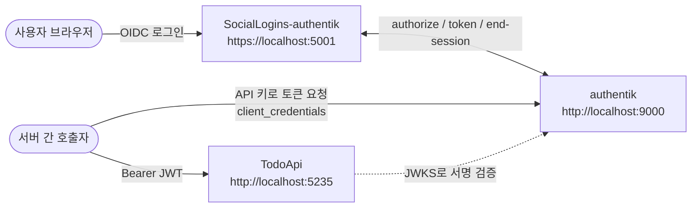

# sso-sample

로컬에서 띄운 [authentik](https://goauthentik.io)을 ID 공급자(IdP)로 쓰는 ASP.NET Core(.NET 10) 연동 샘플 모음입니다.

- **웹앱 SSO 로그인**: OpenID Connect (Authorization Code + PKCE)
- **서버 간 API 호출**: OAuth2 Client Credentials + JWT Bearer 검증

## 구성



| 폴더 | 내용 | 주소 |
|---|---|---|
| [authentik/](authentik/README.md) | authentik 서버 (Docker Compose, PostgreSQL). 앱 등록 정보는 blueprint 파일로 관리 | http://localhost:9000 |
| [SocialLogins-authentik/](SocialLogins-authentik/readme.md) | Razor Pages 웹앱. GitHub와 authentik 로그인 지원, 로그아웃 시 authentik 세션도 종료 | https://localhost:5001 |
| [TodoApi/](TodoApi/README.md) | Minimal API. authentik이 발급한 JWT의 scope(`todo:read` / `todo:write`)로 권한 확인 | http://localhost:5235 |
| [SocialLogins/](SocialLogins/readme.md) | 원본 샘플 (GitHub 로그인만 지원). 비교용 | https://localhost:5001 |

> SocialLogins와 SocialLogins-authentik은 같은 포트를 쓰므로 하나씩 실행합니다.

## 요구 사항

- Docker (Docker Compose v2)
- [.NET 10 SDK](https://dotnet.microsoft.com/download/dotnet/10.0)
- HTTPS 개발 인증서: `dotnet dev-certs https --trust`

## 빠른 시작

명령은 저장소 루트에서 Git Bash로 실행하는 것을 기준으로 합니다.

### 1. authentik 실행

```bash
cd authentik
cp .env.example .env      # 각 항목에 랜덤 값 입력 (.env.example의 주석 참고)
docker compose up -d
```

- 첫 기동에는 몇 분 걸립니다. `docker compose ps`에서 server와 worker가 `healthy`가 될 때까지 기다립니다.
- **http://localhost:9000/** (루트)로 접속해 관리자 `akadmin`의 비밀번호를 설정합니다.
- 각 앱의 등록 정보, 테스트 사용자, 서비스 계정은 [authentik/blueprints/](authentik/blueprints/)에서 자동으로 만들어집니다. 반영되지 않았다면 [authentik/README.md](authentik/README.md)의 수동 적용 방법을 참고하세요.

### 2. SocialLogins-authentik (웹앱 SSO)

```bash
P=SocialLogins-authentik/SocialLogins
dotnet user-secrets set authentik:authority "http://localhost:9000/application/o/sociallogins/" --project $P
dotnet user-secrets set authentik:clientId sociallogins --project $P
dotnet user-secrets set authentik:clientSecret "$(grep '^SOCIALLOGINS_CLIENT_SECRET=' authentik/.env | cut -d= -f2-)" --project $P
dotnet user-secrets set authentik:requireHttpsMetadata false --project $P
dotnet run --project $P
```

https://localhost:5001 → **Sign in using authentik** → `demo` / `DEMO_USER_PASSWORD`(`authentik/.env`)로 로그인합니다.

### 3. TodoApi (서버 간 호출)

```bash
dotnet run --project TodoApi --launch-profile http
```

호출하는 쪽은 API 키(`authentik/.env`의 `TODOAPI_CALLER_KEY`)로 토큰을 받아 Bearer로 호출합니다.

```bash
TOKEN=$(curl -s http://localhost:9000/application/o/token/ \
  -d grant_type=client_credentials -d client_id=todoapi \
  -d username=svc-todo-client \
  --data-urlencode "password=$(grep '^TODOAPI_CALLER_KEY=' authentik/.env | cut -d= -f2-)" \
  --data-urlencode "scope=todo:read todo:write" \
  | node -e "let d='';process.stdin.on('data',c=>d+=c).on('end',()=>console.log(JSON.parse(d).access_token))")

curl -H "Authorization: Bearer $TOKEN" http://localhost:5235/todoitems
```

토큰이 없으면 `401`, scope가 부족하면 `403`입니다. 자세한 내용은 [TodoApi/README.md](TodoApi/README.md)에 있습니다.

## authentik에 등록되는 항목

| 항목 | 용도 | 정의 파일 |
|---|---|---|
| Application/Provider `sociallogins` | 웹앱 OIDC 로그인 (confidential, code + refresh) | [sociallogins.yaml](authentik/blueprints/sociallogins.yaml) |
| 사용자 `demo` | 웹앱 로그인 테스트용 | [sociallogins.yaml](authentik/blueprints/sociallogins.yaml) |
| Application/Provider `todoapi` | API 토큰 발급 (client_credentials만 허용, 토큰 5분) | [todoapi.yaml](authentik/blueprints/todoapi.yaml) |
| Scope `todo:read`, `todo:write` | TodoApi 권한 | [todoapi.yaml](authentik/blueprints/todoapi.yaml) |
| 서비스 계정 `svc-todo-client` + App Password | 서버 간 호출자의 API 키 | [todoapi.yaml](authentik/blueprints/todoapi.yaml) |

## 비밀값 관리

- 비밀번호, client secret, API 키는 모두 `authentik/.env`에만 둡니다. 이 파일은 `.gitignore`로 커밋에서 제외됩니다.
- blueprint는 `!Env`로 `.env` 값을 읽고, 커밋되는 [.env.example](authentik/.env.example)에는 빈 칸만 있습니다.
- 웹앱의 client secret은 .NET user-secrets에 저장합니다.

## 주의

로컬 개발용 구성입니다. authentik을 HTTP로 쓰기 때문에 앱에서 `requireHttpsMetadata=false`를 설정했고, 테스트 사용자와 서비스 계정도 포함되어 있습니다. 운영 환경에서는 HTTPS를 적용하고, 테스트 계정을 제거하고, 비밀값을 별도 저장소로 관리해야 합니다.
